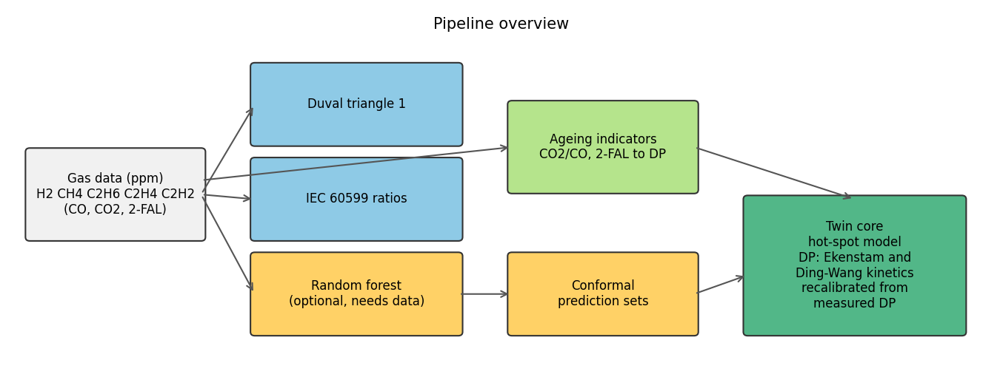
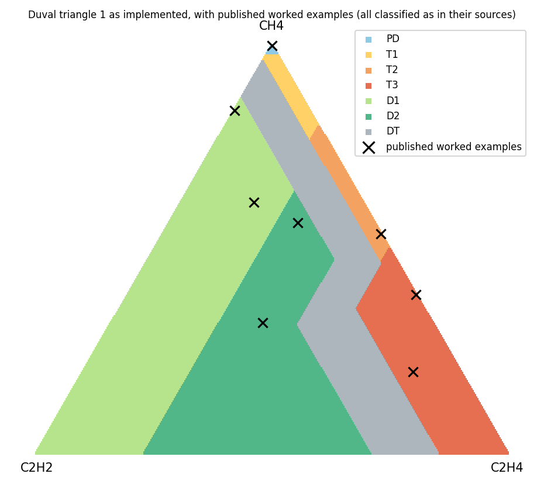
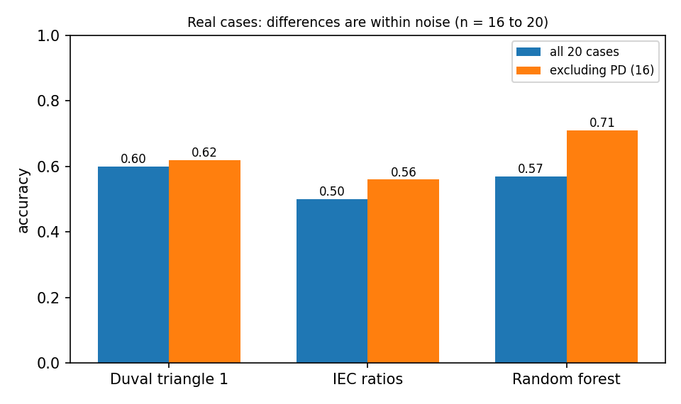
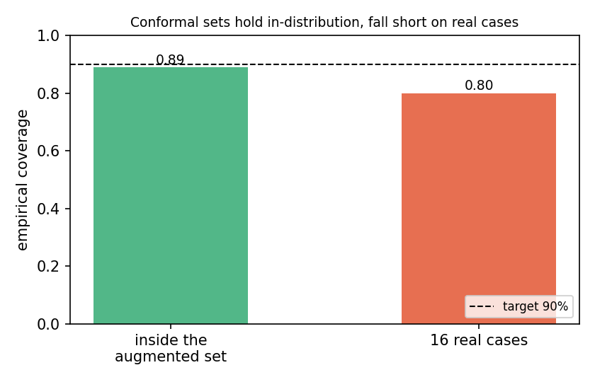
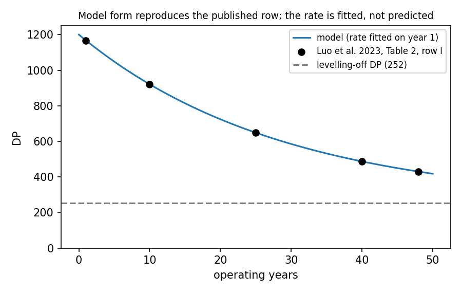
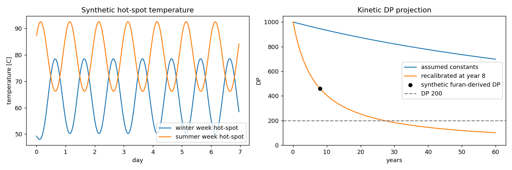

# Transformer DGA diagnosis and a digital-twin core

[](https://github.com/officialanas03/Transformer-DGA-twin/actions)

**Live demo:** https://anas-transformer-dga-twin01.streamlit.app/



Dissolved gas analysis is how engineers listen to a transformer: the gases dissolved in its oil hint at what is going wrong inside. I wanted to see how far the published methods really go on real cases, and how sure a diagnosis should sound. So this project puts Duval's triangle, the IEC ratio method and a random forest side by side, and gives the forest an honest confidence: a set of plausible faults instead of a single confident guess.

## What it does

Paste a gas sample, or upload a CSV of them, and the app returns the Duval zone, the IEC label and, when the training data is available, the forest's set of possible faults. Add CO2/CO or a furan (2-FAL) result and it estimates how worn the paper insulation is.



## What I found

On 20 real transformers the three methods scored 0.60 (Duval), 0.50 (IEC) and 0.57 (forest). That is too few cases to name a winner.



The more interesting result: the forest looked excellent inside its own dataset (about 88% accuracy) but fell to about 62% on real cases, and its 90% confidence sets covered only about 80% of them. The "Normal" label in the training data also disagreed with Duval's triangle on most rows, so I left that class out.



## The twin

The second half simulates how hot a winding gets and how fast its paper ages, and lets one measured DP value correct the prediction. I checked the ageing model against a published study (Luo et al., 2023). It reproduces the shape of their table and their levelling-off value, but the rate has to be fitted, because their printed constants don't give it directly.



The demo below is entirely synthetic (invented load, placeholder thermal parameters, a made-up furan result). It shows how one measurement can overturn an assumed ageing rate, not how a real transformer behaves.



## Try it

Use the live demo above, or run it locally:

```bash
git clone https://github.com/officialanas03/Transformer-DGA-twin.git
cd Transformer-DGA-twin
python -m venv .venv
pip install -r requirements-dev.txt
python -m pytest -q
streamlit run app.py
```

The datasets behind the studies are not redistributed (see [DATA.md](DATA.md)). Without them the random forest is switched off, the rest of the app works, and the data-dependent tests are skipped.

## Limits worth knowing

- Duval's zones were rebuilt from a published figure and checked against worked examples, not against the standard itself.
- The thermal parameters are placeholders; real values come from a transformer's heat-run test report.
- The forest cannot output partial discharge, and it can be confidently wrong.
- Thirteen to twenty real cases is a small sample.
- The public demo is not the place for confidential utility data.

Based on Duval (IEEE Electr. Insul. Mag., 2002), IEC 60599, and Luo et al. (Measurement 222, 2023).

## Licence

MIT. See [LICENSE](LICENSE).
