# Transformer DGA diagnosis and digital-twin core

[](https://github.com/officialanas03/Transformer-DGA-twin/actions)

Dissolved gas analysis (DGA) diagnosis for oil-filled transformers, with uncertainty estimates, and a first
thermal and insulation-ageing core for a transformer digital twin. **Research prototype: not validated for operational use.**

<!-- Live demo: add the Streamlit link here after deployment -->
**Live demo:** _link to be added_

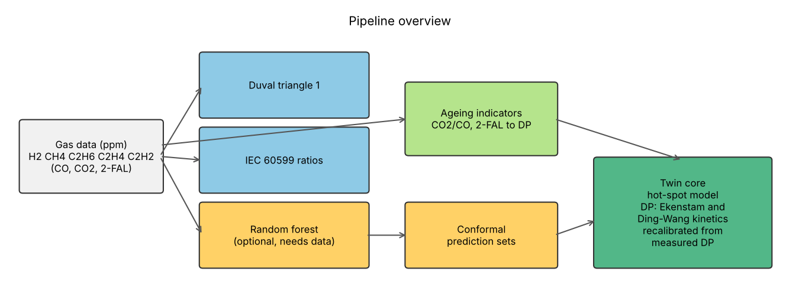

## What it does

- **Diagnose a gas sample** with Duval triangle 1 and the IEC 60599 ratio method, optionally alongside a random
  forest that returns a *set* of plausible faults with a coverage target (conformal prediction).
- **Process a whole CSV** of samples in the app and download the results.
- **Estimate insulation condition** from CO2/CO and from 2-FAL (furan) results via published correlations.
- **Simulate hot-spot temperature and paper ageing** (DP) with two published models, and recalibrate them to a measured DP.
- **Reproduce Luo et al. (2023)** as far as the paper allows, with every fitted, assumed or impossible part labelled.
- **Digital-twin chain**: ANSYS (or finite-volume) winding temperature field, a POD surrogate, an extended Kalman filter for live
  calibration, and DP along the winding. Developed on assumed geometry and SYNTHETIC sensor data until real data exist.

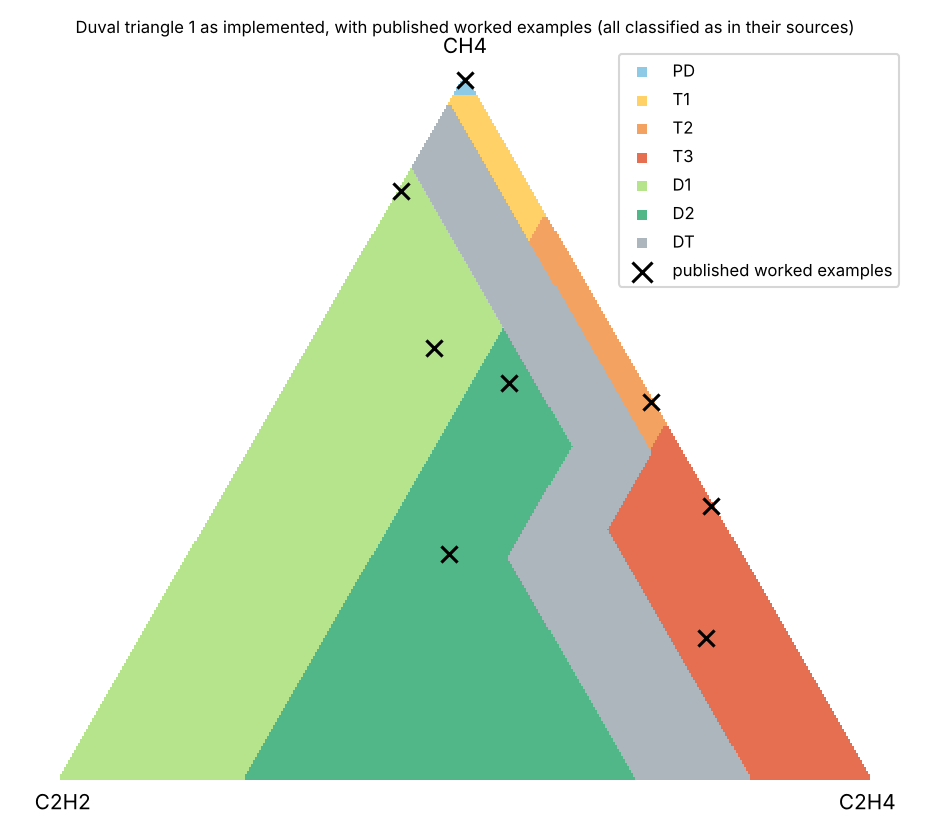

## Quick start

```bash
git clone https://github.com/officialanas03/Transformer-DGA-twin.git
cd Transformer-DGA-twin
python -m venv .venv
# activate: Windows PowerShell  .venv\Scripts\Activate.ps1   |   macOS/Linux  source .venv/bin/activate
pip install -r requirements-dev.txt
python -m pytest -q
streamlit run app.py
```

The datasets used for the studies are not redistributed (see [DATA.md](DATA.md)). Without them the app runs in
rules-only mode (Duval, IEC, ageing indicators, twin) and data-dependent tests are skipped.

## Repository layout

| Part | Files | Purpose |
|---|---|---|
| Rule-based diagnosis | `dga/rules/duval.py`, `iec.py` | Duval triangle 1; IEC 60599 ratio method (reports "undetermined" or "ambiguous" instead of guessing) |
| Machine learning | `dga/ml/`, `dga/eval/`, `dga/pipeline.py` | Features, random forest, calibration metrics, split-conformal sets, one-call diagnosis |
| Ageing indicators | `dga/ageing/paper.py` | CO2/CO bands, 2-FAL to DP (Chendong, De Pablo), furan condition bands |
| Twin core | `twin/thermal.py`, `twin/ageing.py`, `twin/dingwang.py` | Top-oil/hot-spot model; IEC relative ageing rate; Ekenstam and Ding-Wang/Luo DP kinetics |
| Luo reproduction | `reference/luo2023_numbers.csv`, `twin/paper_numbers.py`, `twin/moisture.py`, `twin/luo_chain.py`, `run_luo_table2.py` | Numbers printed in the paper with page references, moisture Eqs. 1-4 and 13, Table 2 chain with labelled variants |
| Temperature field | `ansys/*.inp`, `twin/surface.py`, `twin/ansys_io.py`, `twin/thermal_fv.py`, `examples/ansys/` | APDL scripts (single load and batch), CSV readers, a numpy finite-volume solver of the same assumed model |
| Twin layers | `twin/surrogate.py`, `twin/kalman.py`, `twin/synthetic.py`, `twin/pipeline_dp.py`, `twin/report.py` | POD surrogate, extended Kalman filter, SYNTHETIC data generators, hot-spot-to-DP pipeline |
| Live twin and virtual rig | `twin/rig.py`, `twin/live.py`, `run_virtual_rig.py`, `docs/RIG.md` | SYNTHETIC simulation of a bench rig (coil in oil, probes with offsets, noise, dropouts), logger CSV format, estimator that updates itself as rows arrive, CSV follower for the real logger |
| App | `app.py` | Streamlit app: single sample, batch CSV, thermal/ageing core, Luo reproduction + twin tab, Live rig tab |
| Studies | `run_*.py`, `docs/make_figures.py` | Reproduce the results and figures below |

## Results

On 20 real transformers with a stated fault class (3 of them mixed faults), the three methods cannot be separated:
one case moves a score by 5 points.

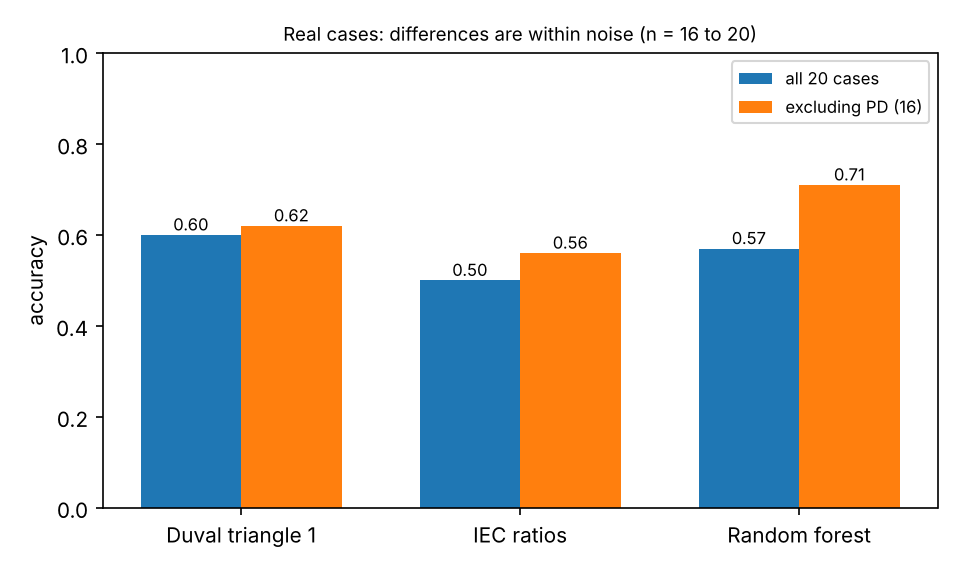

| Study | Result |
|---|---|
| Random forest, 5-fold CV inside the augmented set (no transformer IDs) | accuracy about 0.88 |
| Same forest tested on 13 real cases | accuracy about 0.62 |
| Duval vs the augmented set's labels (non-Normal rows) | agree on 62% |
| "Normal" rows that Duval places in a discharge zone | about 89% |

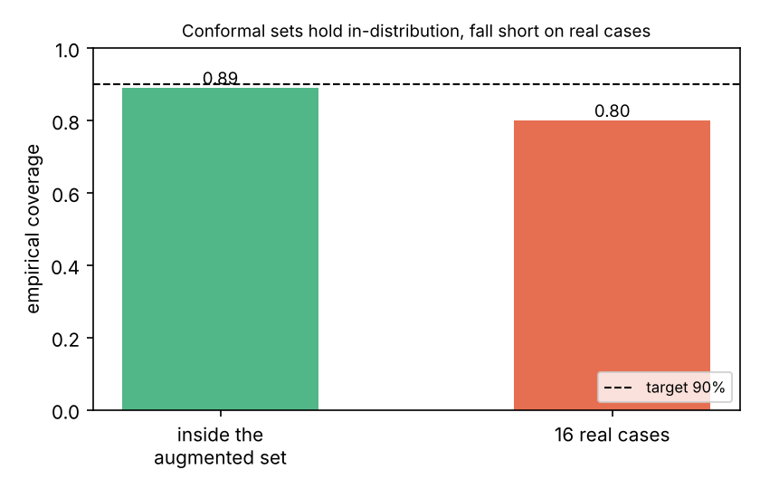

Conformal sets reach their 90% target inside the data they were calibrated on and fall short on real cases, as
expected when the real cases do not resemble the calibration data.

### Reproduction of Luo et al. (Measurement 222, 2023)

Run `python run_luo_table2.py` for the full report. Status, stated plainly:

| Item | Status |
|---|---|
| Levelling-off DP | **Reproduced**: 252.13 against 252.15 (needs C as a fraction in Eq. 11; the paper does not say) |
| Eq. 13, Eq. 4 series | **Reproduced** (series checked against an independent finite-difference solver) |
| Table 2 row I | **Fitted**: one rate constant fitted on year 1, later years within 0.75 DP. Confirms the form, not the rate; the printed constants alone give a rate about 26% too low if k_DP is per day, and the paper states no unit |
| Table 2 rows II, III | **Impossible as printed.** Variants with assumed moisture are shown and do not match (up to 70 DP off); they are not the paper's method |
| "7.4 times faster at 2% than 0.2% moisture" | **Not reproduced**: alpha_C alone gives 2.0x; with Eq. 11's k_DP it is undefined |
| "Time for DP to fall to 250" | **Not possible in the printed model**: the levelling-off DP (252) is above 250 |

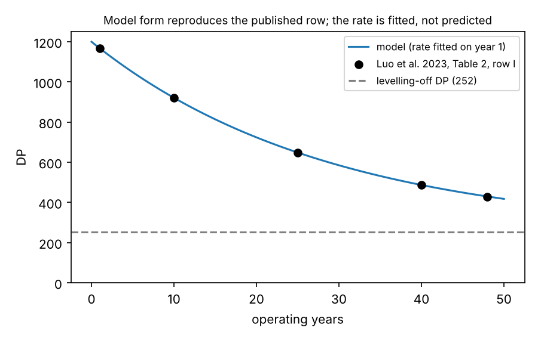
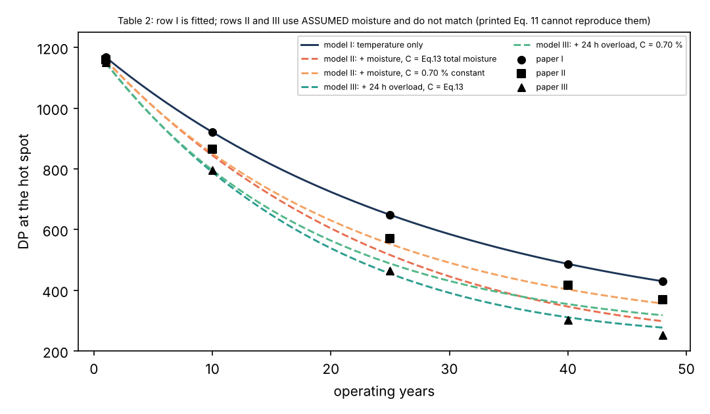

**Why Eq. 11 fails.** k_DP(C) = -1.55C^2 - 0.2015C + 0.0013 (C as a fraction) falls from 0.0013 and crosses zero at 0.616% moisture, while
Eq. 13 already gives 0.70% at year 3 and the paper reports up to 3.2%. Even where it is positive it falls faster than alpha_C rises
(0.5% against 0.18%: k_DP x0.27, alpha_C x1.13), so as printed moisture would slow ageing, contrary to the paper's conclusion. The cited
source for Eq. 11 (ref. [31]) was not retrievable here.

**Other discrepancies found.** Fig. 6 shows 61.5 C for month 1 but Fig. 8 gives 63.51 C as the monitored average (the "3.5%" error is 61.29 against 63.51 for
one month). Eq. 3 as printed is dimensionally inconsistent. Eq. 1's prefactor is 2.173e-5 in the paper but 2.173e-7 in a review that
attributes the equation to Fessler and Rouse (MDPI Energies 17(9):2089, Eq. 14; units of P_V unstated there); under my reading, 10 ppm oil gives
5.7% paper moisture at 20 C, whereas Fig. 9's colour scale spans about 0.5 to 0.8%. This is **unresolved**: do not quote absolute
moisture values from `twin/moisture.py` as findings.

### How much of the Table 3 mismatch is the assumed thermal model?

`python run_thermal_sensitivity.py` refits the film coefficient of four placeholder thermal models to the paper's printed 61.29 C (a **fit**) and reports
the unfitted checks. Year-48 DP at top / middle / bottom of the LV winding, moisture-field variant:

| Variant | LV min (C) | HV hotter than LV? | LV at 1.3 pu (paper 112.84) | LV DP top / mid / bottom (paper 252 / 676 / 928) |
|---|---|---|---|---|
| A: oil 20-40 C, equal loss density (the ANSYS case) | 50.9 | yes (contradicts paper) | 116.8 (+3.5%) | 290 / 338 / 428 |
| B: as A, HV loss density x0.6 | 50.9 | no | 116.8 (+3.5%) | 320 / 394 / 522 |
| C: oil 20-50 C, HV x0.6 | 43.5 | no | 98.1 (-13%) | 335 / 511 / 741 |
| D: oil 20-60 C, HV x0.6 | 31.0 | no | 74.3 (-34%) | 374 / 749 / 1013 |

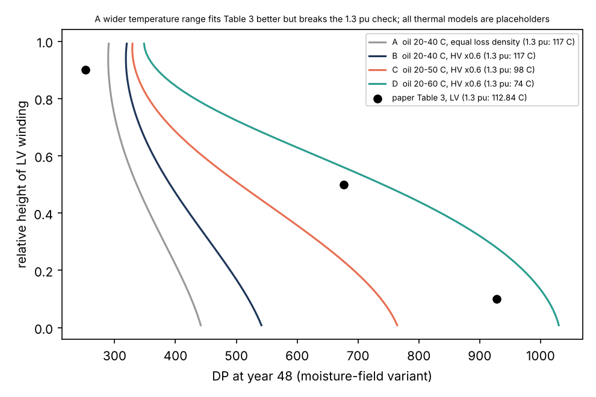

Reading: a wider temperature range (variant D) brings the mid and bottom DP near the paper's values, but breaks the 1.3 pu check, because a smaller
film drop at 0.74 means a smaller rise at overload. With the loss law assumed here (proportional to current squared) the paper's printed temperatures
cannot all be matched together with its Table 3 gradient. Variant B is the best compromise: it keeps the LV winding hotter, as the paper says, and the overload
check (+3.5%), but HV loss density x0.6 is itself an assumption. `ansys/luo_thermal_B.inp` runs variant B in ANSYS (untested; the numpy solver predicts LV 61.29 C at load 0.74).

### Temperature field, surrogate and live calibration

The ANSYS model (`ansys/luo_thermal.inp`) uses an ASSUMED geometry, copper conductivity, losses and oil profile; its film coefficient was tuned so the
LV maximum is near the paper's 61.29 C, which is a **fit**. The 1.3 pu check (117.07 C against the paper's 112.84 C, +3.7%) is a check only for the LV winding.
In this model the **HV winding is hotter** (73.3 C and 156.3 C), which contradicts the paper (LV hotter), and the coolest node is 51 C against about 20 C.
`twin/thermal_fv.py` solves the same model in numpy and agrees with both ANSYS exports within 0.1 K, which is an independent check of the ANSYS runs.

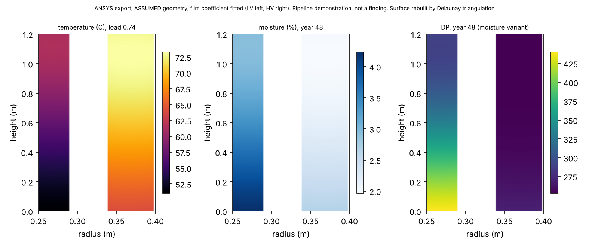

The chain is one-way: temperature field, then moisture, then DP. Moisture at each node is the oil-paper equilibrium shape C_eq(T) scaled so its
radius-weighted mean equals Eq. 13's total moisture for that year (an interpretation, since the paper gives no formula for the distribution; the scaling
makes the result independent of the unresolved absolute prefactor of Eq. 1). Moisture is higher where it is cooler, the opposite trend to temperature,
as the paper describes. Moisture enters DP only through alpha_C with the master curve frozen at 0.18%, a VARIANT. Surfaces are redrawn with the paper's
incremental-insertion Delaunay triangulation (`twin/surface.py`, identical to matplotlib's triangulation on random test points); this changes the picture, not the numbers.

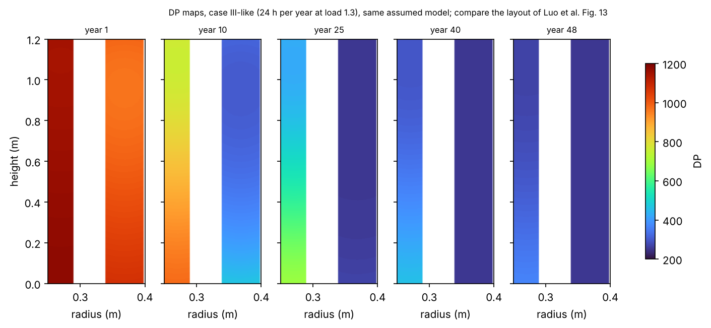

Results with the assumed model, hot-spot (LV maximum) DP in years 1, 10, 25, 40, 48:

| Case | Model | Paper |
|---|---|---|
| II, moisture field | 1156, 833, 499, 333, 288 | 1159, 864, 570, 417, 368 |
| III, + 24 h per year at load 1.3 | 1145, 761, 424, 294, 268 | 1150, 796, 465, 303, 252 |

Year-48 DP at top / middle / bottom of the LV winding is 289 / 334 / 423 (case II) against the paper's 252 / 676 / 927 (Table 3), and the HV winding is almost fully aged
(252 to 264) against 645 / 811 / 879. The paper's top-to-bottom contrast is much stronger because its temperature range is about 20 to 61 C, while this
assumed model's LV winding spans only 51 to 61 C and its HV winding is the hottest part. Maximum moisture at year 48 is 4.2% here against 3.2% in the paper.
These are consequences of the assumed thermal model, which is the part the paper does not describe; they are not agreement or disagreement with the paper.

The POD surrogate (`twin/surrogate.py`) reproduces the finite-volume hot spots to about 0.01 K on held-out points once the inputs are mapped to (load^2, 1/hf);
with plain (load, hf) a cubic fit was off by several kelvin. That accuracy is against the assumed model only. The extended Kalman filter
(`twin/kalman.py`) tracks a drifting film coefficient on **synthetic** data, and also shows its limit: when the oil model is wrong, it hides the error in the film coefficient
(estimate 61 against a true 72), fits the sensor to about 1.6 K, and is 9.8 K off when extrapolated to 1.3 pu. Calibration is not validation.

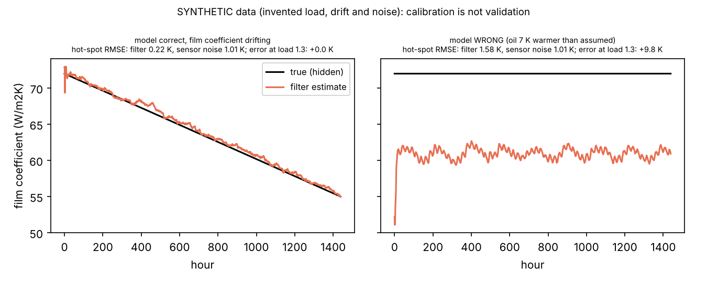

### Live twin on a virtual rig (synthetic)

`twin/rig.py` simulates the proposed bench rig (see `docs/RIG.md`): a heated, paper-wrapped coil in oil with six oil probes and three
hot-spot thermocouples, each with a fixed offset, noise, quantisation and random dropouts, plus a hardware thermostat. It writes the
same CSV the real logger will write. `twin/live.py` reads rows as they arrive (from the simulation, or from a CSV that a logger keeps
appending to), re-estimates the film coefficient with the Kalman filter, predicts the three thermocouples and computes DP. No parameter
is typed in: change what the simulated world does (the "cooling health" slider in the Live rig tab) and the estimate follows.

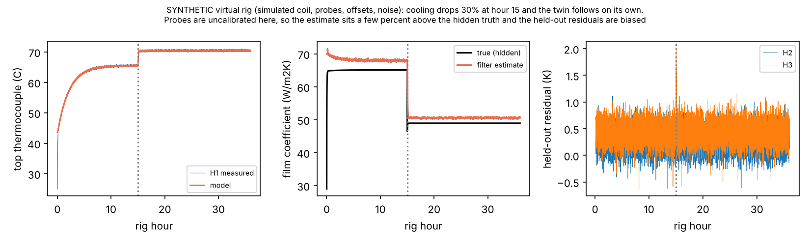

What the tests and runs show (all on simulated data):
* With ideal probes the estimate is within 1 % of the hidden film coefficient at five load levels; with uncalibrated probe offsets the error is 0.6 to 2.5 %
  in the sweep and about 4.5 % in the figure above; giving the twin the true offsets (the calibration step on a real rig) brings it back to under 1 %.
* A 30 % cooling fault is followed (hidden ratio 0.75, estimated 0.75), with no edit of any twin parameter.
* A +2 K fault on a held-out thermocouple raises the held-out error from 0.15 K to 1.4 K and leaves the fitted estimate untouched.
* The limit: with the paper resistance R_paper set twice too large the fitted thermocouple still agrees to about 0.1 K while h is off by about 49 %.
  Calibration is not validation, and the printed standard deviation is statistical only.
* The simulation's own numbers (steady 67 C at 1.0 pu and about 93 C at 1.3 pu, oil time constant about 2.1 h) come from ASSUMED constants listed in `docs/RIG.md`.

Everything here is a model checked against its own simulated data. It shows that the pipeline works; it validates no physics, and the real logger firmware and the rig are not built.

### Twin demonstration (synthetic)

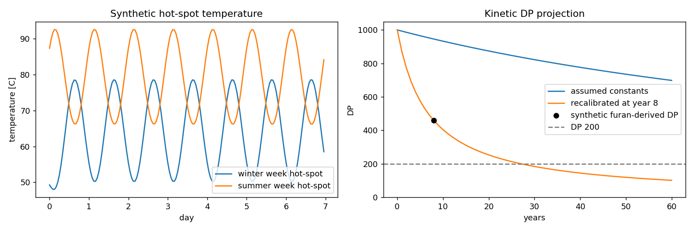

Everything in this figure is synthetic or assumed: invented load and ambient profiles, placeholder thermal
parameters, an assumed life of 180,000 h to DP 200 at a 110 C hot spot, and a made-up 2-FAL result. It shows how one
measurement can overturn an assumed ageing rate; it says nothing about a real transformer.

## Method notes

- **Duval triangle 1** zones were reconstructed from the nine breakpoints printed in Duval (2002), Fig. 1, and checked against nine
  published worked examples. They have not been checked line by line against IEC 60599 or IEEE C57.104.
- **IEC ratios** follow the standard's table as reproduced in two published sources; limits differ slightly between editions and
  sit in one dictionary. The standard's gas-level screening is not applied.
- **Random forest** uses five-gas features (three-gas percentages and three log-ratios), is trained without the "Normal" class
  and has no PD class.
- **Conformal sets**: split conformal with score 1 - p(true class).
- **Twin**: differential-form top-oil and hot-spot equations (exact first-order update per step); IEC relative ageing rate;
  Ekenstam kinetics (Ea about 113 kJ/mol, pre-exponential factor calibrated, no default); Ding-Wang/Luo saturating model.

## Limitations

1. The augmented dataset has no transformer IDs, so cross-validation scores are probably optimistic.
2. Its "Normal" label conflicts with Duval's triangle on most rows, so that class is excluded.
3. The forest cannot output PD and can be confidently wrong on real cases.
4. With 13 to 20 real cases, method comparisons are not statistically meaningful.
5. Thermal parameters are illustrative placeholders; replace them with the heat-run test report values.
6. The IEC exponential thermal form, the Emsley ageing model and the IEC gas-level screening are not implemented.
7. The surrogate and Kalman filter are built and tested only on an assumed model and synthetic data; no real CFD or transformer time series was available. An API service is not built.
8. The DP chain uses a rate fitted to Table 2 row I, and moisture at the hot spot is an assumption; its DP maps are demonstrations, not predictions.
9. The Streamlit tab and its smoke test (`tests/test_app.py`) were written without Streamlit installed in the authoring environment; they run in CI.
10. The batch tab of a public deployment should not be used with confidential data.
11. The virtual rig, its sensors and every number in the Live rig tab are SYNTHETIC; the rig is a proposed design, not built, and the logger firmware is not written.
12. The Live rig tab was tested against a stand-in for Streamlit (`tests/test_live_tab_stub.py`); the real auto-refresh timer needs Streamlit 1.37 or later and was not run in the authoring environment.

## Key references

- Duval, M. "A Review of Faults Detectable by Gas-in-Oil Analysis in Transformers", IEEE Electr. Insul. Mag. 18(3), 2002.
- Luo, H. et al. "A novel approach to building digital twin transformers by combining virtual-real sensing", Measurement 222, 2023.
- IEC 60599, IEC 60076-7, IEEE C57.104, IEEE C57.91.
- Chendong (1991) and De Pablo furan-DP correlations, as compared in IEEE Trans. Power Delivery 28(2), 2013.
- Oil-paper equilibrium equation cross-check: MDPI Energies 17(9):2089 (2024), Eq. 14.
- Ding, H.Z. and Wang, Z.D., "On the degradation evolution equations of cellulose", Cellulose 15, 2008.
- Illias, H.A. and Liang, W.Z., PLOS ONE 13(1): e0191366, 2018.

## Licence

Code: MIT (see [LICENSE](LICENSE)). Datasets are not covered; see [DATA.md](DATA.md).
